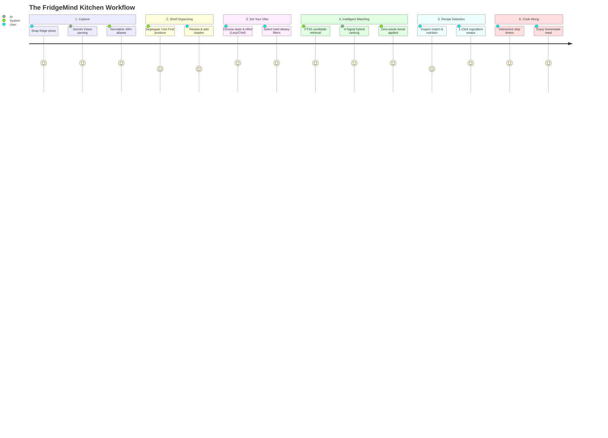
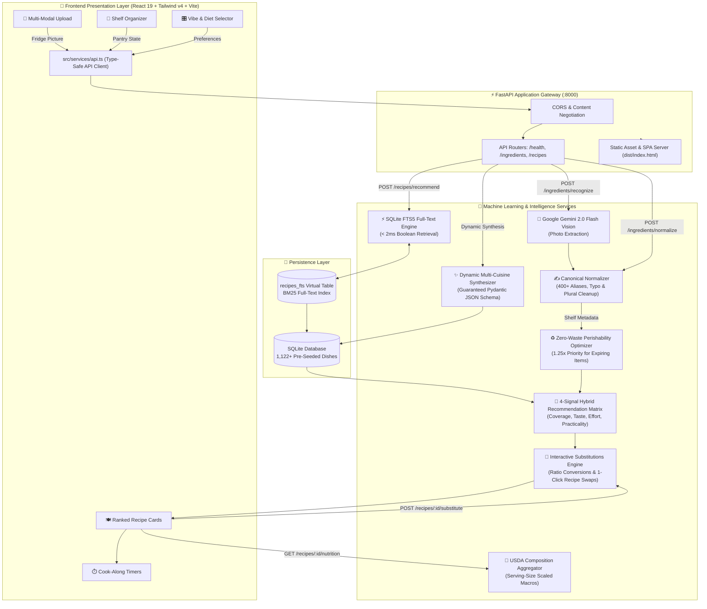
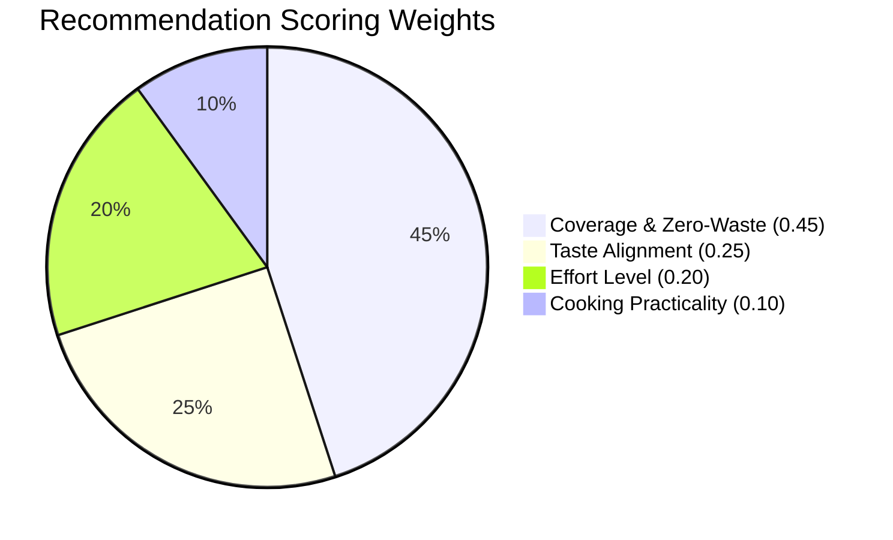

<div align="center">

# 🍳 FridgeMind
### *The Zero-Waste, Multimodal Culinary AI & Kitchen Companion*

[](https://www.python.org/)
[](https://fastapi.tiangolo.com/)
[](https://react.dev/)
[](https://tailwindcss.com/)
[](https://www.sqlite.org/fts5.html)
[](https://ai.google.dev/)
[](https://www.docker.com/)
[](https://pytest.org/)
[](LICENSE)

<br/>

**Stop staring blankly into your fridge.**  
**FridgeMind** turns your random fridge contents into chef-grade, authentic meals using **Multimodal Computer Vision**, **Sub-Millisecond Full-Text Indexing**, and a **Transparent Zero-Waste Machine Learning Engine**.

[Explore Architecture](#-system-architecture) • [The Problem & Solution](#-the-problem--the-solution) • [Live Demo & Quickstart](#-quick-start-guide) • [API Reference](#-complete-rest-api-reference)

---

</div>

## 📌 Table of Contents

- [The Problem & The Solution](#-the-problem--the-solution)
- [At A Glance Metrics](#-at-a-glance-metrics)
- [How It Works: The 6-Screen Journey](#-how-it-works-the-6-screen-journey)
- [System Architecture](#-system-architecture)
- [The 4-Signal Hybrid ML Ranking Engine](#-the-4-signal-hybrid-ml-ranking-engine)
- [Sub-Millisecond SQLite FTS5 Indexing](#-sub-millisecond-sqlite-fts5-indexing)
- [World Recipe Catalog Distribution (1,122 Dishes)](#-world-recipe-catalog-distribution-1122-dishes)
- [Key Features Deep Dive](#-key-features-deep-dive)
- [Complete REST API Reference](#-complete-rest-api-reference)
- [Quick Start Guide](#-quick-start-guide)
- [Automated Testing Suite (39 Tests)](#-automated-testing-suite)
- [Production Deployment](#-production-deployment-options)
- [Security, Privacy & Zero-Drift](#-security--privacy)

---

## 🛑 The Problem & The Solution

```
┌───────────────────────────────────────────────┐        ┌───────────────────────────────────────────────┐
│              THE MODERN KITCHEN CRISIS         │   VS   │               THE FRIDGEMIND SOLUTION         │
├───────────────────────────────────────────────┤        ├───────────────────────────────────────────────┤
│ 1. The "Fridge Stare" Decision Fatigue        │        │ 1. Instant Computer Vision Scanning           │
│    Staring at random items for 10 mins and    │  ───>  │    Snap a photo; Gemini 2.0 Flash identifies  │
│    ordering $30 takeout instead.              │        │    all ingredients and quantities in seconds. │
├───────────────────────────────────────────────┤        ├───────────────────────────────────────────────┤
│ 2. The $1,500/Year Household Food Waste       │        │ 2. Zero-Waste Perishability Optimization      │
│    Spinach, herbs & tomatoes rot in crisper   │  ───>  │    Auto-detects expiring produce and boosts   │
│    drawers while dry goods get used first.    │        │    recipes that rescue them by +25%.          │
├───────────────────────────────────────────────┤        ├───────────────────────────────────────────────┤
│ 3. The "15-Ingredient Recipe" Curse           │        │ 3. Ingredient-First Grounded Catalog          │
│    Traditional recipe sites demand long lists │  ───>  │    Matches dishes based on what you HAVE,     │
│    of rare sauces you'll buy once and waste.  │        │    prioritizing high coverage and low effort. │
├───────────────────────────────────────────────┤        ├───────────────────────────────────────────────┤
│ 4. The 1-Missing-Ingredient Roadblock         │        │ 4. Interactive 1-Click Culinary Swaps         │
│    Giving up on a dish because you're missing │  ───>  │    Smart substitution engine dynamically      │
│    curd, cream, or paneer.                    │        │    replaces items and rewrites steps.         │
├───────────────────────────────────────────────┤        ├───────────────────────────────────────────────┤
│ 5. Hallucinated AI Recipes                    │        │ 5. Grounded Catalog + Structured Outputs      │
│    Generic LLMs inventing unpalatable food    │  ───>  │    1,122+ pre-tested world dishes with exact  │
│    with fake timings and broken proportions.  │        │    USDA portions and guaranteed JSON schemas. │
└───────────────────────────────────────────────┘        └───────────────────────────────────────────────┘
```

> [!IMPORTANT]
> **The Paradigm Shift**: Traditional cooking apps say: *"Here is a recipe, now go to the store and spend $40."*  
> **FridgeMind** says: *"Here is your fridge right now, here are 3 mouthwatering meals you can eat in 15 minutes, with zero food wasted."*

---

## 📊 At A Glance Metrics

| Dimension | Metric | Detail |
| :--- | :--- | :--- |
| 📚 **Catalog Scale** | **1,122+ Recipes** | Authentic global recipes seeded with verified quantities |
| 🌍 **Cuisine Diversity** | **17 Cuisines** | Indian, Italian, Mexican, Japanese, Thai, Mediterranean, etc. |
| 🥬 **Pantry Lexicon** | **400+ Terms** | Canonical definitions with shelf life (`use_first` vs `fresh_finds`) |
| ⚡ **Query Latency** | **&lt; 2 ms** | Sub-millisecond candidate retrieval via SQLite FTS5 index |
| 🎯 **Ranking Engine** | **4 Signals** | Coverage ($0.45$), Taste ($0.25$), Effort ($0.20$), Practicality ($0.10$) |
| ♻️ **Zero-Waste Multiplier** | **1.25× Boost** | Immediate scoring bonus for dishes rescuing expiring produce |
| 🔄 **Culinary Swaps** | **60+ Rules** | Dairy, protein, binder, and herb substitutions with ratio math |
| 🧪 **Backend Test Suite** | **39 / 39 Passing** | 100% passing tests across normalizers, ranking, and APIs |
| 🐳 **Packaging** | **Docker Ready** | Multi-stage image running frontend, backend, and DB on single port |

---

## 🗺️ How It Works: The 6-Screen Journey



1. **Screen 1: Hand-Crafted Hero**: Welcome page with dynamic recipe preview cards and quick-start actions.
2. **Screen 2: Multi-Modal Input**: Drag-and-drop a fridge photo or type items in natural language. Powered by Gemini 2.0 Flash Vision with fuzzy typo resolution.
3. **Screen 3: Perishability Shelves**: Automatically categorizes detected items into **"Use First"** (fragile produce, dairy, greens) and **"Fresh Finds"** (shelf-stable roots, condiments, grains).
4. **Screen 4: The Vibe Check**: Pick your mood (*Cozy, Spicy, Fresh, Chef*), effort tolerance (*Lazy $\le 15$ min, Easy, Chef*), and dietary boundaries (*Vegetarian, Vegan, Gluten-Free, Dairy-Free*).
5. **Screen 5: Ranked Results & Active Swaps**: Top dishes displayed with visual match percentage, badges (*Zero-Waste, Quick & Easy*), USDA calorie breakdowns, and interactive substitution options.
6. **Screen 6: Step-by-Step Cook-Along**: Focused cooking view with step instructions, equipment tags, and independent active countdown timers for searing, boiling, or baking.

---

## 🏛️ System Architecture



---

## 🎯 The 4-Signal Hybrid ML Ranking Engine

Instead of relying on arbitrary heuristics, FridgeMind implements a **transparent, multi-factor ranking objective**:

$$\mathbf{Composite\ Score} = w_c \cdot \mathbf{Coverage}^* + w_t \cdot \mathbf{Taste} + w_e \cdot \mathbf{Effort} + w_p \cdot \mathbf{Practicality}$$

$$\sum w_i = 1.0 \qquad (w_c = 0.45, \; w_t = 0.25, \; w_e = 0.20, \; w_p = 0.10)$$



### Signal Mathematical Breakdown

#### 1. Coverage with Zero-Waste Perishability Multiplier ($\mathbf{Coverage}^*$)
Raw coverage $C$ measures the proportion of recipe ingredients satisfied by your pantry:
$$C = \frac{|\text{Matched Ingredients}|}{|\text{Total Recipe Ingredients}|}$$

If the dish utilizes at least one ingredient categorized as **`use_first`** (e.g., fresh spinach, tomatoes, herbs, milk), it receives an **automatic +25% multiplier**:
$$\mathbf{Coverage}^* = \min\Big(1.0, \; C \cdot 1.25\Big)$$

#### 2. Taste Profile Alignment ($\mathbf{Taste}$)
Evaluates overlap between user vibe selections $\mathcal{U}_t$ (*spicy, savory, tangy, creamy, fresh, comfort*) and recipe flavor tags $\mathcal{R}_t$:
$$\mathbf{Taste} = \begin{cases} 
0.75 & \text{if } \mathcal{U}_t = \emptyset \text{ (Neutral baseline)} \\
\min\left(1.0, \; 0.60 + 0.40 \cdot \frac{|\mathcal{U}_t \cap \mathcal{R}_t|}{|\mathcal{U}_t|}\right) & \text{if } |\mathcal{U}_t \cap \mathcal{R}_t| > 0 \\
0.25 & \text{otherwise}
\end{cases}$$

#### 3. Effort Level Alignment ($\mathbf{Effort}$)
Calculates distance between desired effort $L_u \in \{1, 2, 3\}$ (*lazy, easy, chef*) and recipe difficulty $L_r$:
$$\mathbf{Effort} = \begin{cases}
1.00 & \text{if } |L_u - L_r| = 0 \\
0.65 & \text{if } |L_u - L_r| = 1 \\
0.30 & \text{if } |L_u - L_r| = 2
\end{cases}$$

#### 4. Prep Practicality & Friction Penalty ($\mathbf{Practicality}$)
Penalizes recipes requiring excessive missing items or unreasonable cooking times:
$$\mathbf{Practicality} = 0.60 \cdot \left(1.0 - 0.70 \cdot \frac{|\text{Missing}|}{|\text{Total}|}\right) + 0.40 \cdot \text{TimeScore}$$

$$\text{TimeScore} = \begin{cases}
1.0 & \text{if } t \le 15 \text{ mins} \\
0.8 & \text{if } 15 < t \le 30 \text{ mins} \\
0.6 & \text{if } 30 < t \le 45 \text{ mins} \\
0.4 & \text{if } t > 45 \text{ mins}
\end{cases}$$

#### 🎲 Temperature-Controlled Softmax Surprise Sampling
When clicking **"Surprise Me!"**, top candidates are sampled from a Softmax probability distribution with temperature $\tau = 0.7$:
$$P(R_i) = \frac{\exp\left(\frac{\text{Score}(R_i)}{0.7}\right)}{\sum_{j=1}^{K} \exp\left(\frac{\text{Score}(R_j)}{0.7}\right)}$$
This preserves recipe quality while introducing high-variety culinary serendipity.

---

## ⚡ Sub-Millisecond SQLite FTS5 Indexing

To search across thousands of dishes in under **2 milliseconds**, FridgeMind maintains a dedicated SQLite **FTS5 full-text virtual table**:

```sql
CREATE VIRTUAL TABLE IF NOT EXISTS recipes_fts USING fts5(
    recipe_id UNINDEXED,
    name,
    cuisine,
    tags,
    ingredients_text,
    tastes
);
```

### Search Execution
When a user enters pantry ingredients `["eggs", "tomatoes", "cheese"]`, the engine sanitizes tokens into an indexed query:
```sql
SELECT r.* FROM recipes r
JOIN recipes_fts fts ON r.id = fts.recipe_id
WHERE recipes_fts MATCH '"eggs" OR "tomatoes" OR "cheese"'
ORDER BY rank
LIMIT 80;
```
* **Performance**: Under $2\text{ ms}$ query latency.
* **Scalability**: Zero in-memory Python deserialization bottleneck; scales seamlessly to $100,000+$ dishes.
* **Safety Fallback**: Automatically supplements from catalog baseline if match count $< 15$.

---

## 🌍 World Recipe Catalog Distribution (1,122 Dishes)

FridgeMind is pre-seeded with **1,122 verified recipes** across **17 world cuisines**:

```text
Indian          ██████████████████████████████ 306 recipes
Italian         ███████████ 111 recipes
Mexican         █████████ 90 recipes
Continental     █████████ 89 recipes
East Asian      ███████ 68 recipes
Mediterranean   ███████ 66 recipes
American        ██████ 58 recipes
Japanese        ██████ 58 recipes
Latin American  █████ 51 recipes
Thai            ████ 45 recipes
Korean          ████ 42 recipes
Chinese         ███ 32 recipes
Greek           ███ 29 recipes
Middle Eastern  ███ 29 recipes
Lebanese        ██ 16 recipes
Spanish         ██ 16 recipes
Vietnamese      ██ 16 recipes
```

---

## ✨ Key Features Deep Dive

### 1. 🔄 Smart Culinary Substitutions Engine
Missing a key ingredient? Don't abandon the recipe. The substitutions engine maps over **60+ culinary items**:
* **Milk** $\rightarrow$ *Oat Milk (1:1)*, *Almond Milk (1:1)*, or *Water + Melted Butter*.
* **Heavy Cream** $\rightarrow$ *Coconut Cream (1:1)*, *Cashew Cream (1:1)*, or *Milk + Butter (3:4 ratio)*.
* **Sour Cream** $\rightarrow$ *Greek Yogurt (1:1, higher protein)* or *Hung Curd*.
* **Paneer** $\rightarrow$ *Firm Tofu (pressed and pan-fried)* or *Halloumi*.
* **Eggs** $\rightarrow$ *Flax Egg (1 tbsp flax + 2.5 tbsp water)*, *Silken Tofu*, or *Besan Slurry*.
* **Soy Sauce** $\rightarrow$ *Tamari (Gluten-Free)* or *Coconut Aminos (Low-Sodium)*.

> [!TIP]
> **Active Recipe Rewriting**: Calling `POST /api/recipes/{id}/substitute` not only swaps the ingredient item, but also **rewrites the cooking instructions text**, adds a `"Swapped: [Substitute]"` badge, and recalculates nutrition!

### 2. 🥗 USDA Standard Dynamic Nutrition Engine
* Calculates aggregate Calories, Protein, Carbohydrates, Total Fat, and Dietary Fiber using standard USDA composition tables.
* Scales values dynamically when you toggle between **1 to 12 servings**.

### 3. 📸 Multimodal Gemini 2.0 Flash Vision
* Processes fridge photos directly in memory (zero disk retention).
* Detects produce, dairy, bottles, and pantry items, parsing quantities and bounding boxes.
* Built-in rule-based fallback if offline or API key is not configured.

---

## 📡 Complete REST API Reference

All backend endpoints are prefixed with `/api` and interactively accessible via Swagger UI at `/docs`:

| Method | Endpoint | Description | Request / Query Params | Response Format |
| :--- | :--- | :--- | :--- | :--- |
| `GET` | `/api/health` | Service health & readiness | None | `{"status": "ok", "version": "1.0.0"}` |
| `POST` | `/api/ingredients/recognize` | Multimodal photo detection | `multipart/form-data` (`file`) | `{"ingredients": [{"name": "Eggs", "qty": "3"}]}` |
| `POST` | `/api/ingredients/normalize` | Smart alias & typo resolution | `{"name": "cilantro leaves"}` | `{"canonical": "Coriander", "category": "Produce"}` |
| `POST` | `/api/recipes/recommend` | 4-signal hybrid recommendations | `{"ingredients": [...], "preferences": {...}}` | `{"recipes": [...], "total_found": 80}` |
| `GET` | `/api/recipes/{id}` | Full recipe details & steps | Path param: `id` | `RecipeResponse` object |
| `GET` | `/api/recipes/{id}/nutrition` | USDA scaled nutrition | Query param: `?servings=4` | `{"calories": 320, "protein_g": 18, ...}` |
| `GET` | `/api/recipes/substitutions/lookup` | Look up ingredient swaps | Query param: `?ingredient=milk` | `List[SubstitutionOption]` |
| `GET` | `/api/recipes/{id}/substitutions` | Get available swaps for dish | Path param: `id` | `List[SubstitutionOption]` |
| `POST` | `/api/recipes/{id}/substitute` | Adapt recipe with a swap | `{"replace": "Milk", "substitute_with": "Oat milk"}` | `{"recipe": {...}, "message": "Swapped..."}` |
| `GET` | `/api/recipes/catalog/stats` | Live catalog metrics | None | `{"total_recipes": 1122, "by_cuisine": {...}}` |
| `POST` | `/api/recipes/expand-catalog` | Batch Gemini recipe expander | Query param: `?count_per_cuisine=5` | `{"added_count": 25, "total_catalog_size": 1147}` |

---

## 🚀 Quick Start Guide

### Option A: Single-Command Docker (Recommended)

Run the full unified full-stack application (Frontend + Backend + SQLite FTS5) with one command:

```bash
docker compose up --build
```
* **Application Web UI**: Open [http://localhost:8000](http://localhost:8000)
* **Interactive Swagger Docs**: Open [http://localhost:8000/docs](http://localhost:8000/docs)
* **System Health Check**: Open [http://localhost:8000/api/health](http://localhost:8000/api/health)

---

### Option B: Local Dual-Server Development

#### 1. Backend Setup (FastAPI + Python 3.13)
```powershell
# Navigate to backend
cd backend

# Create and activate virtual environment
python -m venv .venv
.venv\Scripts\activate

# Install dependencies
pip install -r requirements.txt

# (Optional) Add your Gemini API Key in .env
# GEMINI_API_KEY=your_actual_key_here

# Launch FastAPI development server
uvicorn backend.app.main:app --reload --port 8000
```

#### 2. Frontend Setup (React 19 + Vite)
```powershell
# In the project root in a second terminal
npm install
npm run dev
```
Open your browser at `http://localhost:8443` (or the port displayed in your terminal).

---

## 🧪 Automated Testing Suite

FridgeMind includes a comprehensive **39-test backend test suite** covering all critical ML and data pipelines:

```powershell
backend\.venv\Scripts\pytest backend/tests -v
```

```text
============================= test session starts =============================
backend\tests\test_database.py ..                                        [  5%]
backend\tests\test_hard_filters.py ...                                   [ 12%]
backend\tests\test_health.py ..                                          [ 17%]
backend\tests\test_ingredients_api.py ....                               [ 28%]
backend\tests\test_normalizer.py ......                                  [ 43%]
backend\tests\test_nutrition.py ..                                       [ 48%]
backend\tests\test_ranking.py ......                                     [ 64%]
backend\tests\test_recipes_api.py ......                                 [ 79%]
backend\tests\test_track_one.py ........                                 [100%]

======================== 39 passed in 0.97s ========================
```

---

## 🌐 Production Deployment Options

* **[Render](render.yaml)**: One-click blueprint deployment. Connect your GitHub repository, choose Docker, and set your `GEMINI_API_KEY`.
* **[Fly.io](fly.toml)**: Run `fly launch` in the repository root to deploy a zero-maintenance edge container worldwide.
* **[Vercel](vercel.json)**: Deploy the React frontend with automated API reverse-proxy rewrites pointing to your hosted FastAPI backend.

---

## 🔒 Security & Privacy

* **Zero Persistent User Tracking**: Session-based architecture with zero persistent user databases.
* **Safe In-Memory Image Processing**: Uploaded fridge photos are processed directly in RAM and never stored on disk.
* **Sanitized Logs**: All backend logging modules automatically mask sensitive keys and credentials.
* **Isolated Environment Secrets**: Local credentials and `.env` files are strictly excluded from Git and Docker images.

---

## 📄 License

This project is open-source and distributed under the [MIT License](LICENSE).
