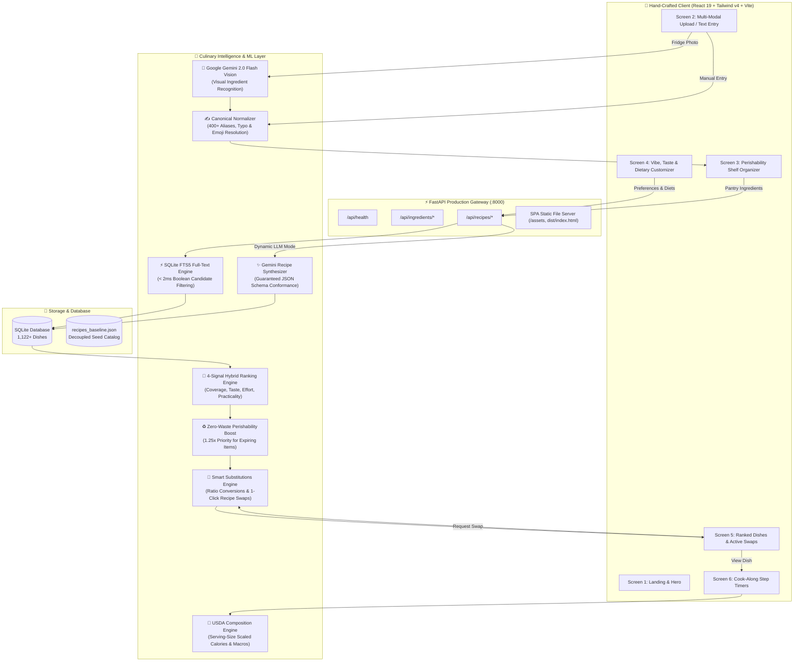
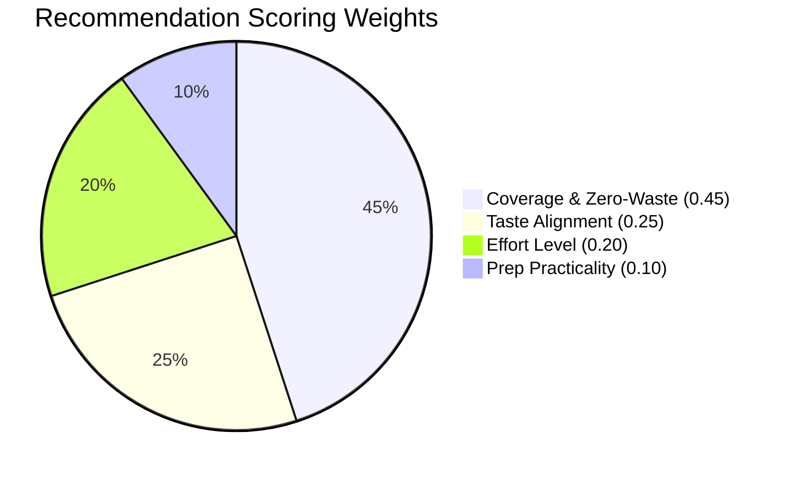

# 🍳 FridgeMind — Intelligent Kitchen Companion & Zero-Waste Culinary AI

[](https://www.python.org/)
[](https://fastapi.tiangolo.com/)
[](https://react.dev/)
[](https://tailwindcss.com/)
[](https://www.sqlite.org/fts5.html)
[](https://ai.google.dev/)
[](https://www.docker.com/)
[](https://pytest.org/)
[](LICENSE)

> **Transform whatever is in your fridge into delicious, authentic dishes.**  
> Powered by **Multimodal Vision AI**, **Sub-Millisecond SQLite FTS5 Candidate Retrieval**, a **Transparent 4-Signal Hybrid Ranking Engine**, and an **Interactive Culinary Substitutions Engine**.

---

## 🌟 At a Glance Metrics

| Metric | Measurement | Description |
| :--- | :--- | :--- |
| 📚 **Catalog Size** | **1,122+ Recipes** | Authentic seeded recipes with zero hallucinated measurements |
| 🌍 **Global Cuisines** | **17 Cuisines** | Indian, Italian, Mexican, Japanese, Thai, Mediterranean, etc. |
| 🥬 **Pantry Vocab** | **400+ Terms** | Canonical ingredients with shelf perishability & regional aliases |
| ⚡ **Retrieval Speed** | **&lt; 2 ms** | High-performance full-text search via SQLite FTS5 virtual indexing |
| 🎯 **Recommendation** | **4 Signals** | Coverage (0.45), Taste (0.25), Effort (0.20), Practicality (0.10) |
| ♻️ **Zero-Waste Boost** | **+25% Priority** | Automated prioritization for expiring perishables (`use_first`) |
| 🧪 **Test Coverage** | **39 / 39 Tests** | Comprehensive automated backend testing suite |
| 🐳 **Packaging** | **Docker Ready** | Unified multi-stage container for Render, Fly.io, & Docker Compose |

---

## 🏛️ System Architecture



---

## 🎯 4-Signal Hybrid Recommendation Formula

FridgeMind does not rely on opaque black-box recommendations. It utilizes a **transparent, mathematically grounded 4-signal objective function**:

$$\mathbf{Composite\ Score} = 0.45 \cdot \mathbf{Coverage}^* + 0.25 \cdot \mathbf{Taste} + 0.20 \cdot \mathbf{Effort} + 0.10 \cdot \mathbf{Practicality}$$

$$\text{Match Percentage} = \text{clamp}\Big(\text{round}\big(\text{Composite Score} \times 100\big), \; 60, \; 99\Big)$$

### Signal Breakdown



1. **Coverage ($C^*$, 45% Weight)**: Proportion of recipe ingredients available in your pantry. Recipes utilizing expiring produce from your **`use_first`** shelf receive an automatic **+25% multiplier**:
   $$C^* = \min\Big(1.0, \; \text{Coverage} \times 1.25\Big)$$
2. **Taste Profile Alignment ($T$, 25% Weight)**: Evaluates overlap between your chosen vibes (*spicy, savory, tangy, sweet, comfort, creamy, fresh*) and the recipe's culinary flavor tags.
3. **Effort Level Match ($E$, 20% Weight)**: Aligns with your current energy level (**Lazy** $\le$ 15 min one-pan meals, **Easy** 20–30 min weekday dinners, **Chef** multi-pot culinary showcases).
4. **Cooking Practicality ($P$, 10% Weight)**: Factors in active preparation duration and missing ingredient friction.

### 🎲 Temperature-Controlled Surprise Mode
When clicking **"Surprise Me!"**, top candidates are sampled using a **Softmax distribution with temperature $\tau = 0.7$**:
$$P(R_i) = \frac{\exp\left(\frac{\text{Score}(R_i)}{0.7}\right)}{\sum_j \exp\left(\frac{\text{Score}(R_j)}{0.7}\right)}$$
This preserves recipe quality while introducing delightful culinary serendipity.

---

## 📊 Catalog Distribution (1,122 Recipes)

FridgeMind ships pre-seeded with **1,122 curated, authentic recipes** across **17 world cuisines**:

```text
Indian          ██████████████████████████████ 306 recipes
Italian         ███████████ 111 recipes
Mexican         █████████ 90 recipes
Continental     █████████ 89 recipes
East Asian      ███████ 68 recipes
Mediterranean   ███████ 66 recipes
American        ██████ 58 recipes
Japanese        ██████ 58 recipes
Latin American  █████ 51 recipes
Thai            ████ 45 recipes
Korean          ████ 42 recipes
Chinese         ███ 32 recipes
Greek           ███ 29 recipes
Middle Eastern  ███ 29 recipes
Lebanese        ██ 16 recipes
Spanish         ██ 16 recipes
Vietnamese      ██ 16 recipes
```

---

## ✨ Key Features Deep Dive

### 1. 📸 Multimodal Fridge Photo Recognition
Upload or drag-and-drop a photo of your refrigerator or kitchen counter. Powered by **Google Gemini 2.0 Flash Vision**, it extracts structured food items, quantities, and confidence levels with safe rule-based offline fallbacks.

### 2. 🧠 Canonical Normalizer & Shelf Perishability
* Automatically resolves regional pantry aliases (*e.g., `cilantro` ↔ `coriander`, `curd` ↔ `yogurt`, `paneer` ↔ `cottage cheese`, `besan` ↔ `chickpea flour`*).
* Segregates items into **Perishable (`use_first`)** vs **Shelf-Stable (`fresh_finds`)** to minimize food waste.

### 3. ⚡ Sub-Millisecond SQLite FTS5 Full-Text Search
Full-text indexing over recipe names, cuisines, tags, ingredients, and taste notes delivers **candidate retrieval in under 2ms**, completely eliminating slow table scans.

### 4. 🔄 Smart Culinary Substitutions Engine
Missing heavy cream, paneer, eggs, or sour cream?
* The engine provides **authentic culinary swaps** with ratio adjustments (*e.g., Greek yogurt for sour cream [1:1], flax eggs for baking, oat milk for dairy*).
* **1-Click Recipe Adaptation**: Automatically updates recipe steps, ingredient lists, tags, and appends a `"Swapped: [Substitute]"` badge.

### 5. 🥗 Dynamic USDA Nutritional Scaling
Calculates calories, protein, carbs, fats, and fiber scaled dynamically to your desired serving size ($1$ to $12$ portions).

### 6. ⏱️ Interactive Cook-Along Timers
Step-by-step cooking guide with independent countdown timers for simmering, boiling, and baking, complete with pause, resume, and active step highlighting.

---

## 📡 REST API Reference

All backend endpoints are prefixed with `/api` and documented interactively via Swagger UI:

| Method | Endpoint | Description | Sample Request / Query |
| :--- | :--- | :--- | :--- |
| `GET` | `/api/health` | System health check & metadata | `curl http://localhost:8000/api/health` |
| `POST` | `/api/ingredients/recognize` | Multimodal photo ingredient detection | Multipart file upload (`image/jpeg`, `image/png`) |
| `POST` | `/api/ingredients/normalize` | Smart alias & typo resolution | `{"name": "cilantro leaves"}` |
| `POST` | `/api/recipes/recommend` | 4-signal hybrid recipe recommendations | `{"ingredients": [...], "preferences": {...}}` |
| `GET` | `/api/recipes/{id}` | Complete recipe details & instructions | `GET /api/recipes/1` |
| `GET` | `/api/recipes/{id}/nutrition` | USDA-standard scaled nutrition | `GET /api/recipes/1/nutrition?servings=4` |
| `GET` | `/api/recipes/substitutions/lookup`| Culinary ingredient swap options | `GET /api/recipes/substitutions/lookup?ingredient=milk` |
| `GET` | `/api/recipes/{id}/substitutions` | Feasible substitutions for a recipe | `GET /api/recipes/1/substitutions` |
| `POST` | `/api/recipes/{id}/substitute` | Dynamically adapt recipe with a swap | `{"replace": "Milk", "substitute_with": "Oat milk"}` |
| `GET` | `/api/recipes/catalog/stats` | Live catalog size & cuisine metrics | `GET /api/recipes/catalog/stats` |
| `POST` | `/api/recipes/expand-catalog` | Gemini-powered batch catalog generator | `POST /api/recipes/expand-catalog?count_per_cuisine=5` |

---

## 🚀 Quick Start Guide

### Option A: Single-Command Docker Run (Recommended)

Run the unified full-stack application (React UI + FastAPI + SQLite FTS5) in a single container:

```bash
docker compose up --build
```
* **Application UI & API**: Open [http://localhost:8000](http://localhost:8000)
* **Interactive Swagger Docs**: Open [http://localhost:8000/docs](http://localhost:8000/docs)
* **API Health Check**: Open [http://localhost:8000/api/health](http://localhost:8000/api/health)

---

### Option B: Local Dual-Server Development

#### 1. Backend Setup (FastAPI)
```powershell
# Navigate to backend
cd backend

# Create and activate virtual environment
python -m venv .venv
.venv\Scripts\activate

# Install dependencies
pip install -r requirements.txt

# (Optional) Set your Gemini API Key in .env
# GEMINI_API_KEY=your_actual_key_here

# Run backend server
uvicorn backend.app.main:app --reload --port 8000
```

#### 2. Frontend Setup (React + Vite)
```powershell
# In project root in a second terminal
npm install
npm run dev
```
Open your browser at `http://localhost:8443` (or port displayed in terminal).

---

## 🧪 Automated Testing Suite

Run the comprehensive **39-test backend test suite**:

```powershell
backend\.venv\Scripts\pytest backend/tests -v
```

```text
backend\tests\test_database.py ..                    [ 5%]
backend\tests\test_hard_filters.py ...               [12%]
backend\tests\test_health.py ..                      [17%]
backend\tests\test_ingredients_api.py ....           [28%]
backend\tests\test_normalizer.py ......              [43%]
backend\tests\test_nutrition.py ..                   [48%]
backend\tests\test_ranking.py ......                 [64%]
backend\tests\test_recipes_api.py ......             [79%]
backend\tests\test_track_one.py ........             [100%]

======================== 39 passed in 0.97s ========================
```

---

## 🌐 Cloud Deployment Options

FridgeMind includes ready-to-deploy configuration manifests for popular platforms:

* **[Render](render.yaml)**: One-click blueprint deployment. Connect your repository, choose Docker, and set `GEMINI_API_KEY`.
* **[Fly.io](fly.toml)**: Run `fly launch` in the root folder to deploy an edge container worldwide.
* **[Vercel](vercel.json)**: Deploy frontend with automated reverse-proxy API rewrites.

---

## 🔒 Security & Privacy

* **Zero Persistent User Accounts**: Pure session-based architecture with zero personal user tracking.
* **Ephemeral In-Memory Image Processing**: Uploaded fridge photos are processed in memory and never stored on disk.
* **Sanitized Logging**: All backend loggers automatically mask credentials and API keys.
* **Secret Protection**: `.env` and SQLite database binaries are strictly ignored via `.gitignore` and `.dockerignore`.

---

## 📄 License

This project is open-source and licensed under the [MIT License](LICENSE).
