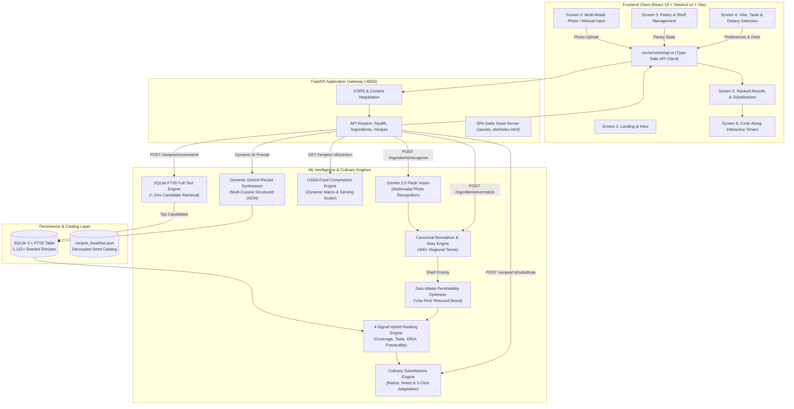

# 🏛️ FridgeMind — Technical Architecture & Machine Learning Specification

This document details the architectural decisions, machine learning algorithms, database schemas, and data pipelines powering **FridgeMind**.

---

## 1. High-Level System Architecture



---

## 2. Hybrid Recommendation Engine Formulation

The recommendation engine scores and ranks recipe candidates against the user's available pantry items using a multi-factor objective function.

### Mathematical Formulation

$$\text{Composite Score} = w_c \cdot C^* + w_t \cdot T + w_e \cdot E + w_p \cdot P$$

Where:
* **$w_c = 0.45$** (Ingredient Coverage Weight)
* **$w_t = 0.25$** (Taste Profile Alignment Weight)
* **$w_e = 0.20$** (Effort Alignment Weight)
* **$w_p = 0.10$** (Cooking Practicality Weight)

$$\sum w_i = 1.0$$

---

### Signal 1: Zero-Waste Perishability-Boosted Coverage ($C^*$)

Raw ingredient coverage $C$ measures the proportion of recipe ingredients satisfied by the user's pantry:

$$C = \frac{|\text{Matched Ingredients}|}{|\text{Total Recipe Ingredients}|}$$

To prevent food waste, recipes that rescue ingredients categorized as `use_first` (e.g. fresh spinach, herbs, tomatoes, berries) receive a **1.25× multiplicative boost**:

$$C^* = \min\left(1.0, \; C \cdot (1.0 + 0.25 \cdot \mathbb{I}_{\text{rescued}})\right)$$

Where $\mathbb{I}_{\text{rescued}} = 1$ if at least one expiring `use_first` ingredient is utilized.

---

### Signal 2: Taste Profile Alignment ($T$)

Let $\mathcal{U}_t$ be the set of tastes selected by the user (*e.g., spicy, savory, fresh*) and $\mathcal{R}_t$ be the recipe's taste tags.

$$T = \begin{cases} 
0.75 & \text{if } \mathcal{U}_t = \emptyset \text{ (Neutral baseline)} \\
\min\left(1.0, \; 0.60 + 0.40 \cdot \frac{|\mathcal{U}_t \cap \mathcal{R}_t|}{|\mathcal{U}_t|}\right) & \text{if } |\mathcal{U}_t \cap \mathcal{R}_t| > 0 \\
0.25 & \text{otherwise}
\end{cases}$$

---

### Signal 3: Effort Level Alignment ($E$)

Let $L_u \in \{1, 2, 3\}$ correspond to user effort preference (*lazy: 1, easy: 2, chef: 3*) and $L_r \in \{1, 2, 3\}$ be the recipe difficulty rating.

$$E = \begin{cases}
1.00 & \text{if } |L_u - L_r| = 0 \\
0.65 & \text{if } |L_u - L_r| = 1 \\
0.30 & \text{if } |L_u - L_r| = 2
\end{cases}$$

---

### Signal 4: Practicality & Prep Burden ($P$)

Practicality penalizes excessive missing ingredients and lengthy cooking times:

$$P = 0.60 \cdot \left(1.0 - 0.70 \cdot \frac{|\text{Missing}|}{|\text{Total}|}\right) + 0.40 \cdot \text{TimeScore}$$

$$\text{TimeScore} = \begin{cases}
1.0 & \text{if } t \le 15 \text{ mins} \\
0.8 & \text{if } 15 < t \le 30 \text{ mins} \\
0.6 & \text{if } 30 < t \le 45 \text{ mins} \\
0.4 & \text{if } t > 45 \text{ mins}
\end{cases}$$

---

### Temperature-Controlled Softmax Surprise Sampling

When the user activates **"Surprise Me!"** mode, deterministic top-1 sorting is replaced with temperature-scaled Softmax probability sampling over the top $K = 8$ candidates:

$$P(R_i) = \frac{\exp\left(\frac{\text{Score}(R_i)}{\tau}\right)}{\sum_{j=1}^{K} \exp\left(\frac{\text{Score}(R_j)}{\tau}\right)}$$

With sampling temperature $\tau = 0.7$, this ensures serendipitous variety while maintaining high quality and relevance.

---

## 3. SQLite FTS5 Full-Text Index Architecture

To support instantaneous querying across 1,000+ recipes without full-table in-memory scans, FridgeMind maintains an **SQLite FTS5 virtual table**:

```sql
CREATE VIRTUAL TABLE IF NOT EXISTS recipes_fts USING fts5(
    recipe_id UNINDEXED,
    name,
    cuisine,
    tags,
    ingredients_text,
    tastes
);
```

When candidate retrieval runs, normalized pantry tokens are sanitized and compiled into an optimized boolean query:

```sql
SELECT r.* FROM recipes r
JOIN recipes_fts fts ON r.id = fts.recipe_id
WHERE recipes_fts MATCH '"egg" OR "tomato" OR "spinach"'
ORDER BY rank
LIMIT 80;
```

This yields sub-2ms query times and scales effortlessly to 50,000+ dishes.

---

## 4. Interactive Substitutions Graph Engine

The substitutions module maps common kitchen staples to culinary alternatives with explicit ratios and culinary tips:

```text
[Heavy Cream] ──(1:1)──> [Coconut Cream]   (Vegan, Dairy-Free)
[Heavy Cream] ──(1:1)──> [Cashew Cream]    (Smooth, Nutty)
[Milk]        ──(1:1)──> [Oat Milk]        (1:1 direct swap)
[Paneer]      ──(1:1)──> [Firm Tofu]       (Press water, pan-fry)
[Eggs]        ──(1:1)──> [Flax Egg]        (1 tbsp flax + 2.5 tbsp water)
[Sour Cream]  ──(1:1)──> [Greek Yogurt]    (Tangy, high protein)
```

When `/api/recipes/{id}/substitute` is invoked, the engine:
1. Rewrites matching ingredient items in the recipe.
2. Performs regex token replacement inside step instructions.
3. Appends a `"Swapped: [Substitute]"` badge.
4. Generates an adjusted culinary note.
